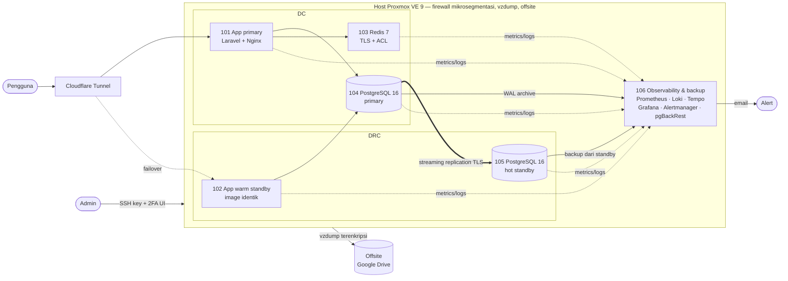

# Proxmox Homelab — Architecture as Code

Homelab satu mesin fisik yang dirancang dengan prinsip infrastruktur **perbankan**:
ketersediaan tinggi, RPO/RTO terukur, enkripsi di setiap jalur, hak akses minimum,
audit trail, dan **setiap prosedur pemulihan diuji dengan drill sungguhan**.

Seluruh lapisan — dari host fisik, mesin virtual, sampai aplikasi — didefinisikan
sebagai kode dengan **Terraform** dan **Ansible**.

> Laptop bekas (Intel i7-8750H, RAM 32 GB, 1 NIC) → Proxmox VE 9 → 6 LXC Ubuntu 24.04
> → stack aplikasi + database HA + PITR + observability + firewall mikrosegmentasi.

---

## Daftar isi

- [Arsitektur](#arsitektur)
- [Lapisan as Code](#lapisan-as-code)
- [Peran setiap node](#peran-setiap-node)
- [Perlindungan data (RPO/RTO)](#perlindungan-data-rporto)
- [Keamanan](#keamanan)
- [Observability](#observability)
- [Hasil drill](#hasil-drill)
- [Struktur repo](#struktur-repo)
- [Memulai](#memulai)
- [Runbook](#runbook)
- [Pelajaran penting](#pelajaran-penting)

---

## Arsitektur



## Lapisan as Code

| Lapisan | Alat | Isi |
|---|---|---|
| **1. Fisik** — host Proxmox | Ansible | Hardening SSH/fail2ban, firewall mikrosegmentasi, backup vzdump + offsite terenkripsi, node exporter, identitas Terraform (least privilege) |
| **2. Virtual** — LXC | Terraform (`bpg/proxmox`) | CPU, RAM, disk, mount point, jaringan, DNS, flag firewall, autostart. LXC lama di-*import* tanpa dibuat ulang, dilindungi `prevent_destroy` |
| **3. Software** — isi LXC | Ansible (24 role) | Aplikasi, database HA, Redis, PITR, observability, CA internal & TLS |

Prinsip yang dipegang di seluruh repo:

- **Idempotent** — setiap playbook dijalankan dua kali; run kedua harus `changed=0`.
- **Kode = kenyataan** — perubahan di luar kode (mis. hot-add disk) selalu diikuti
  penyesuaian kode sampai `terraform plan` → `No changes`.
- **Secret tidak pernah plaintext** — Ansible Vault (password di macOS Keychain),
  token Terraform di Keychain, kunci privat TLS dibuat di server tujuan dan tidak
  pernah keluar.
- **Dry-run & pengaman** — operasi berisiko (failover, rebuild, restore) menampilkan
  rencana dulu dan butuh konfirmasi eksplisit.

## Peran setiap node

| Node | Peran | Isi |
|---|---|---|
| **101** DC-APP-ENGINE | Aplikasi primary | Laravel (PHP-FPM) + Nginx, Grafana Alloy (log Docker & OTLP) |
| **102** DRC-APP-STANBY | Warm standby aplikasi | Image Docker **byte-identik** (`docker save \| load`), kode dicerminkan (`rsync --delete`), selalu menyala |
| **103** DC-WORKER-OR-REDIS | Cache, session, antrean | Redis 7: **TLS wajib** (port plaintext dimatikan), ACL (perintah berbahaya dicabut), AOF, `noeviction` |
| **104** DC-DATABASE | Core database | PostgreSQL 16, replication slot, arsip WAL, audit login |
| **105** DRC-REPLICA-DB | DR database | Hot standby via streaming replication **TLSv1.3**, siap dipromosikan |
| **106** BACKUP-AND-MONITORING | Observability & repositori backup | Prometheus, Loki, Tempo, Grafana, Alertmanager, Blackbox, repositori pgBackRest (disk terpisah) |

## Perlindungan data (RPO/RTO)

| Risiko | Perlindungan | RPO | RTO |
|---|---|---|---|
| Server database mati | Streaming replication + `failover-db.yml` | detik | ±30 detik (terukur saat drill) |
| Kesalahan manusia (`DROP`/`DELETE`) | **PITR** pgBackRest (backup dari replika, repo AES-256) | ≤ 60 detik | menit |
| Aplikasi primary mati | Warm standby identik | 0 (stateless, session di DB) | menit (ubah origin tunnel) |
| LXC rusak | vzdump harian ke HDD terpisah | 24 jam | menit |
| Host / disk rusak | Offsite Google Drive terenkripsi (rclone crypt) | 1 minggu | jam |

Jadwal: pgBackRest full Minggu & differential harian 01:00, `pg_dump` 01:30,
vzdump 02:00, verifikasi repositori mingguan, offsite Minggu 05:00.

## Keamanan

- **Mikrosegmentasi firewall di hypervisor** — default `DROP` untuk lalu lintas masuk
  setiap LXC; hanya jalur yang dibutuhkan diizinkan per tier (app / cache / db / monitoring).
  Tidak bisa dimatikan dari dalam LXC, bahkan oleh root. Diverifikasi dengan matriks
  33 uji (lolos & blokir).
- **Port Docker dibatasi lewat chain `DOCKER-USER`** — UFW tidak bisa memblokir port
  yang di-publish Docker.
- **TLS internal dengan CA sendiri** — CA ECDSA P-384 (kunci terenkripsi vault);
  sertifikat server ECDSA P-256 ditandatangani via CSR, diperpanjang otomatis,
  dipantau masa berlakunya.
- **PostgreSQL** — `pg_hba` per host (`/32`), replikasi wajib `hostssl`, user
  replikasi & monitoring terpisah dengan hak minimum, log setiap login + IP klien.
- **Akses host** — SSH key-only, fail2ban (SSH & login Web UI), 2FA TOTP Proxmox,
  unattended-upgrades, sysctl hardening jaringan.
- **Terraform** — user khusus tanpa password, token privsep, role yang tidak bisa
  mengubah user/permission atau mematikan host.

## Observability

- **Metrics**: node exporter (6 LXC + host), PostgreSQL & Redis exporter, status backup
  (vzdump, offsite, pg_dump, pgBackRest, arsip WAL) via textfile collector, thin pool LVM.
- **Logs**: journald semua host (sshd, fail2ban, UFW, PostgreSQL, systemd) + log Docker
  → Loki via Grafana Alloy.
- **Uptime**: Blackbox HTTP/TCP/TLS (termasuk validasi & masa berlaku sertifikat).
- **Alert**: ±25 rule (host down, disk, replikasi terputus/tertinggal, arsip WAL gagal,
  backup terlambat, sertifikat hampir kedaluwarsa, Redis memori) → email via Alertmanager.
- **Dashboard**: *Homelab Overview* (38 panel, dibuat dengan [tools/gen_homelab_dashboard.py](tools/gen_homelab_dashboard.py))
  + Node Exporter Full, PostgreSQL, Blackbox — semua di-provision otomatis.

## Hasil drill

Prosedur pemulihan yang belum pernah diuji dianggap tidak ada. Semua drill di bawah
dijalankan pada sistem yang sedang melayani aplikasi:

| Drill | Hasil |
|---|---|
| Replika dimatikan 3 menit | Alert terkirim dalam ±2,5 menit; 1000/1000 baris yang ditulis selama replika mati tersusul lewat replication slot |
| Switchover 104 → 105 → 104 | Failback otomatis penuh dalam 33 detik, gangguan tulis aplikasi **28 detik**, data utuh |
| PITR | Tabel di-`DROP`, dipulihkan ke detik sebelum `DROP` — 500/500 baris kembali; produksi tidak disentuh |
| Aktivasi firewall pada DB & app produksi | 0 dari 166 request gagal |
| Aktivasi arsip WAL (restart PostgreSQL) | 0 request gagal |

Drill pertama switchover sempat menimbulkan gangguan ±6 menit karena replika yang
dipromosikan hanya listen `localhost` — bug itu yang membuat playbook sekarang
memverifikasi primary baru terjangkau dari host aplikasi **sebelum** mengalihkan trafik.

## Struktur repo

```
├── site.yml                    # Seluruh arsitektur, fase 0-7
├── inventory.ini.example       # Host & group (peran) - IP contoh 192.168.100.x
├── group_vars/
│   ├── all/main.yml.example    # Variabel umum (IP host, port, jadwal backup)
│   ├── all/secrets.yml.example # Contoh secret (asli: secrets.yml, Ansible Vault)
│   ├── all/local.yml.example   # Contoh nilai jaringan lokal (IP admin)
│   └── <group>.yml             # Rule UFW per peran
├── roles/                      # 24 role
├── playbooks/                  # Deploy per komponen, failover, drill, backup
├── terraform/                  # Lapis virtual (bpg/proxmox) + tf.sh (token dari Keychain)
├── tools/                      # Generator dashboard Grafana
├── pki/                        # CA internal (dibuat otomatis, tidak di-commit)
└── vault-pass.sh               # Password Ansible Vault dari macOS Keychain
```

## Memulai

Prasyarat: Proxmox VE 9, LXC Ubuntu 24.04 (unprivileged, `nesting=1`), macOS dengan
`ansible` & `terraform` (Homebrew).

File berisi nilai jaringan/perangkat tidak di-commit; repo hanya memuat versi
`*.example` dengan IP contoh. Akhiran `.example` sengaja dipakai agar Ansible
tidak memuatnya sebagai variabel.

```bash
# 1. Nilai jaringan, secret & nilai lokal (sesuaikan IP dengan jaringan Anda)
cp inventory.ini.example inventory.ini
cp group_vars/all/main.yml.example group_vars/all/main.yml
cp group_vars/all/local.yml.example group_vars/all/local.yml          # IP admin
cp terraform/terraform.tfvars.example terraform/terraform.tfvars      # inventaris LXC
cp group_vars/all/secrets.yml.example group_vars/all/secrets.yml   # isi lalu:
ansible-vault encrypt group_vars/all/secrets.yml
security add-generic-password -a ansible-vault -s proxmoxmqr-home -w   # password vault

# 2. Identitas Terraform di Proxmox (token disimpan otomatis ke Keychain)
ansible-playbook playbooks/setup-terraform-access.yml

# 3. Lapis virtual
cd terraform && ./tf.sh init && ./tf.sh plan && ./tf.sh apply && cd ..

# 4. Seluruh arsitektur
ansible-playbook site.yml
```

IP & nama host di `inventory.ini`, `group_vars/all/main.yml` dan `terraform.tfvars`
harus konsisten satu sama lain.

## Runbook

```bash
# Failover database (tanpa confirm = hanya tampilkan rencana)
ansible-playbook playbooks/failover-db.yml -e mode=switchover -e confirm=FAILOVER-DB
ansible-playbook playbooks/failover-db.yml -e mode=failover   -e confirm=FAILOVER-DB
ansible-playbook playbooks/rebuild-replica.yml -e confirm=REBUILD-REPLICA

# Drill PITR (aman, tidak menyentuh produksi)
ansible-playbook playbooks/pitr-drill.yml

# Backup manual / deploy aplikasi (standby ikut tersinkron)
ansible-playbook playbooks/backup-now.yml -e offsite=true
ansible-playbook playbooks/deploy-apps.yml

# Firewall: lihat diff / rollback darurat
ansible-playbook playbooks/deploy-firewall.yml --check
ansible-playbook playbooks/deploy-firewall.yml -e pve_fw_enabled=false
```

## Pelajaran penting

- **`prevent_destroy` menyelamatkan produksi.** Provider Terraform menganggap
  penambahan mount point sebagai *replace* container — tanpa pengaman, `apply` akan
  menghapus seluruh stack monitoring.
- **Drill menemukan bug yang tidak terlihat di review.** Replika yang dipromosikan
  hanya listen `localhost`; dua host yang "sama" ternyata beda karena konfigurasi manual.
- **Konfigurasi lama yang tidak aktif itu berbahaya.** File firewall per-LXC lama
  (IP usang) akan memutus aplikasi dari database begitu flag firewall dinyalakan.
- **`terraform plan` setelah setiap perubahan di luar Terraform.** Menyalakan firewall
  lewat `pct set` tanpa memperbarui kode membuat apply berikutnya mematikannya lagi.
- **Paket bisa mengubah kepemilikan direktori.** pgBackRest meng-`chown` titik mount
  repositori; Redis exporter tidak bisa membaca CA di `/etc/redis` (0750).
- **Jaringan Docker bukan LAN.** Container Prometheus men-scrape host-nya sendiri dari
  IP bridge Docker — perlu rule UFW tersendiri.

## Kredit

Dashboard komunitas Grafana (di-*vendor* dengan revisi terkunci, sumber tercatat di
deskripsi masing-masing): Node Exporter Full (1860), PostgreSQL Database (9628),
Blackbox Exporter (13659).
